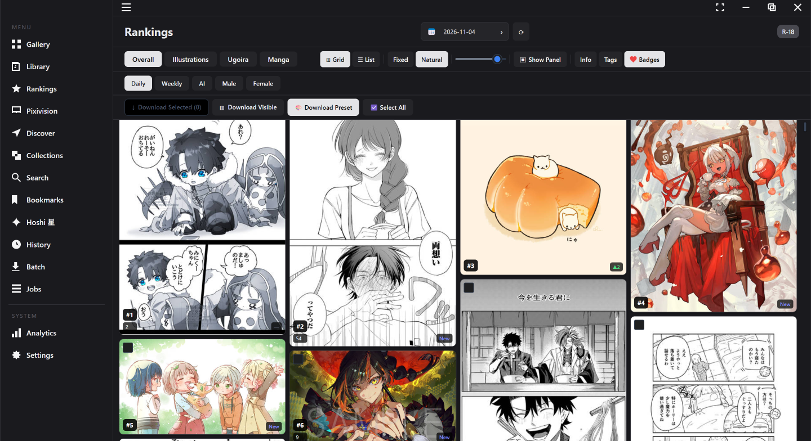

<div align="center">
  
  <h1>Pikura · ピクラ</h1>
  <p>A modern desktop manager for Pixiv artwork — browse, download, schedule, and organise your collection.</p>

  [](https://github.com/pikura-app/pikura/releases/latest)
  [](LICENSE)
  [](https://dotnet.microsoft.com)
  [](#download)

  <br/>

  [](https://ko-fi.com/mrplusultra)
  [](https://www.patreon.com/mrplusultra/join)

  <br/>
</div>

---

## Screenshots


---

## Features

- **Gallery browser** — browse your Pixiv feed and followed artists with grid or list view; expand any artwork inline via the side panel with metadata, tags, and quick actions (Prev/Next, Artist, Popup, Copy, Favorite, Hoshi)
- **Bookmarks** — browse and manage your Pixiv bookmarks (public and private) in one place
- **Rankings** — browse daily/weekly/AI/male/female Pixiv rankings
- **Discover** — explore recommended and trending artwork from Pixiv
- **Library** — search everything you've downloaded by title, artist, pixiv tags and AI tags; filter by character and series; find duplicates; reverse-search images
- **Collections & Collage** — browse and download Pixiv collections, or combine any artworks into a collage tab
- **Pixivision, Search & Viewed history** — read Pixivision articles, search artworks/artists/users globally, and revisit everything you've opened
- **History** — view your previously downloaded artworks with timestamps
- **Analytics** — charts and stats for your download history and collection
- **Image editor** — non-destructive adjustments (brightness, contrast, saturation, hue, temperature, tint, highlights, shadows, blur, sharpness), color overlay, opacity slider, and live GPU-accelerated preview; export to PNG with alpha preserved
- **Batch download** — download entire artist galleries, bookmark collections, or search results; paginates through Pixiv's API to honour your Max Results setting
- **Schedules** — set recurring auto-downloads with per-schedule content filters and tag rules
- **Content filters** — skip AI-generated, Manga, Ugoira, R-18, R-18G content globally or per schedule
- **Tag filters** — include/exclude artworks by tag
- **FANBOX support** — download FANBOX posts alongside Pixiv artwork
- **Multi-account** — switch between multiple Pixiv accounts from the sidebar
- **Per-account settings** — override download root, filename templates, and filters per account
- **Hoshi AI** — chat about artworks with a local Ollama vision model; organised chat history with folders and archive; Hoshi can search, download and find similar art for you
- **AI tagging** — local anime tagger (GPU-accelerated via DirectML) for automatic Danbooru-style tags
- **Resumable downloads** — interrupted downloads continue where they left off, with automatic rate-limit handling
- **Metadata export** — CSV, TSV, JSON or text, on demand or alongside every download
- **Touch & pen** — pinch zoom, flick between pages, and a touch mode
- **Languages** — English, 日本語, 中文, 한국어
- **Auto-updater** — checks for updates on startup, downloads silently in the background, and installs with one click
- **System tray** — runs quietly in the background with tray icon and notifications
- **Themes** — light, dark, and system-default mode

## Download

| Platform | Installer | Portable |
|----------|-----------|----------|
| **Windows** | [Pikura-windows.exe](https://github.com/pikura-app/pikura/releases/latest) (Velopack, delta updates) | [.zip](https://github.com/pikura-app/pikura/releases/latest) |
| **macOS** | [Pikura.dmg](https://github.com/pikura-app/pikura/releases/latest) | — |
| **Linux** | [.AppImage](https://github.com/pikura-app/pikura/releases/latest) | [.tar.gz](https://github.com/pikura-app/pikura/releases/latest) |

> **macOS note:** Pikura is not notarised. On first launch right-click → Open to bypass Gatekeeper.
>
> **Windows note:** the legacy `Pikura-*-Setup.exe` (Inno Setup) still ships only so older versions can auto-update once; new installs should use `Pikura-*-windows.exe` (Velopack — delta updates, per-user install).

## What's New in v2.5

- **Library** — every file you download (plus your existing download folders) is indexed and searchable by title, artist, pixiv tags and AI tags, with folders, Character/Series filters, a duplicate finder and reverse image search. Untagged images are tagged automatically in the background.
- **A smarter Hoshi** — chats open instantly and can be searched, pinned, archived, filtered and sorted into folders; each artwork keeps its own chat and image (downloaded files included); Hoshi can search, download and find similar art for you; a Stop button cancels long answers.
- **GPU acceleration** — the anime tagger runs on your GPU via DirectML (about 3× faster in testing) with automatic CPU fallback, and Hoshi can optionally use integrated GPUs such as Intel Arc.
- **Touch and pen support** — tap vs. scroll, pinch to zoom, free drag, page flicking, and a dedicated touch mode.
- **Reliable downloads** — interrupted downloads resume where they left off, pixiv rate limits are waited out with a visible countdown, and unreliable networks are handled gracefully.
- **Metadata export** — save artwork details as CSV, TSV, JSON or text, with or without downloading.
- **Fully translated** — the whole interface is available in English, Japanese, Chinese and Korean, and switches language instantly.
- **Faster Windows updates** — Velopack installer with small delta updates.

**2.5.1** fixed the Pixivision tab after a pixivision.net site change; **2.5.2** fixed overlapping cards in Natural-height layouts. See the [full release notes](RELEASE_NOTES.md).

## Requirements

- A Pixiv account
- Windows 10+, macOS 12+, or a modern Linux distro
- No separate .NET installation needed — the download is self-contained

## Building from source

**Prerequisites:** [.NET 10 SDK](https://dotnet.microsoft.com/download)

```bash
git clone https://github.com/pikura-app/pikura.git
cd pikura
dotnet build src/Pikura.Avalonia/Pikura.Avalonia.csproj
dotnet run --project src/Pikura.Avalonia/Pikura.Avalonia.csproj
```

## Project structure

```
src/
  Pikura.Core/        # Business logic, API clients, download services
  Pikura.Avalonia/    # Avalonia UI — views, viewmodels, assets
tools/
  MakeIco/            # CLI tool to generate pikura.ico from SVG
  installer/          # Inno Setup script for Windows installer
  convert-icon.ps1    # SVG → ICO helper script
.github/workflows/
  release.yml         # CI — builds & publishes all platforms on git tag
```

## Releasing

```bash
git tag v1.0.0
git push origin v1.0.0
```

GitHub Actions builds Windows, macOS, and Linux automatically and attaches them to the release.

### Windows artifacts

| Artifact | Purpose |
|----------|---------|
| `Pikura-{ver}-windows.exe` | **Velopack** setup — per-user install, delta updates (new installs) |
| `Pikura-{ver}-Setup.exe` | Legacy Inno Setup installer — kept so pre-Velopack clients can auto-update |
| `Pikura-{ver}-windows-portable.zip` | Portable zip (legacy updater) |
| `releases.win.json`, `assets.win.json`, `*.nupkg` | Velopack update feed + full/delta packages (GithubSource reads these) |

- **Team roles**: committers and approvers — mrplusultra.
- **Privacy**: Pikura does not transfer information to networked systems unless the user requests it. The only network features are: pixiv/FANBOX API access when you sign in, the automatic GitHub update check (can be changed in Settings), Ollama on localhost, and AI model downloads initiated by the user.

## License

Pikura is free and open-source software licensed under the [GNU General Public License v3.0](LICENSE).
You may use, study, modify, and redistribute it — including commercially — as long as any distributed derivative is also released under GPLv3 with its full source code.

**Commercial licensing:** If you want to use Pikura's code in a closed-source or proprietary product, or otherwise need terms other than the GPL, a separate commercial license is available from the copyright holder. Contact [mrplusultra@outlook.com](mailto:mrplusultra@outlook.com).

© 2026 mrplusultra
